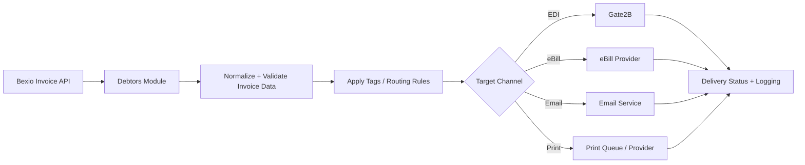

# Architecture

## Application Structure

Main module composition from `Docker/files/src/app.module.ts`:

- `BexioUserModule`
- `DebtorsModule`
- `CreditorsModule`
- `ConfigurationModule`
- `DashboardModule`
- `ContactImportModule`
- `DatabaseModule`

## Request Flow

1. Client calls API endpoint under `api/v1/*`.
2. Controller validates/transforms input via global `ValidationPipe`.
3. Service executes business logic and calls DB/external APIs.
4. Response is returned as JSON.

## Runtime and Transport

- Server bootstraps in `Docker/files/src/main.ts`.
- Listens on port `3001`.
- Uses HTTPS options in development if local cert files exist.
- Session middleware uses Redis store and signed cookies.

## Integrations

- Bexio REST APIs (`BEXIO_API` in config)
- Redis for session storage
- Prisma-managed database connections
- Additional connectors in codebase (Salesforce, DynamoDB)

## Environment Boundaries

- Local/Dev: Swagger enabled at `/api`
- Non-dev: restricted CORS list (`BEXIO_APP_URL`, `BILLING_URL`)

## Invoice Routing Flow (Debtors)

Use this as the primary business flow for debtor invoice distribution:

## Diagram Placeholder (System-Wide)

Add full system diagram file at `docs/assets/architecture-overview.png` and embed it here when ready.
