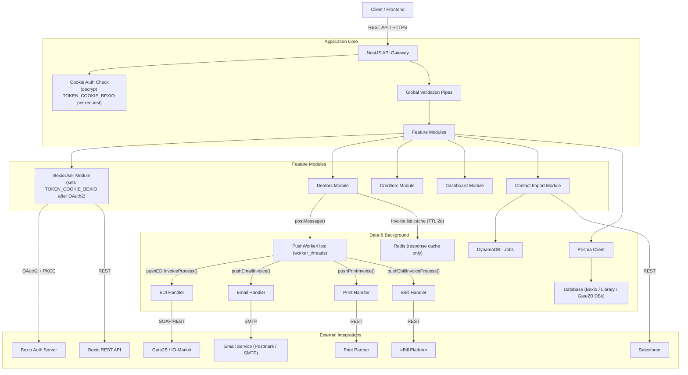
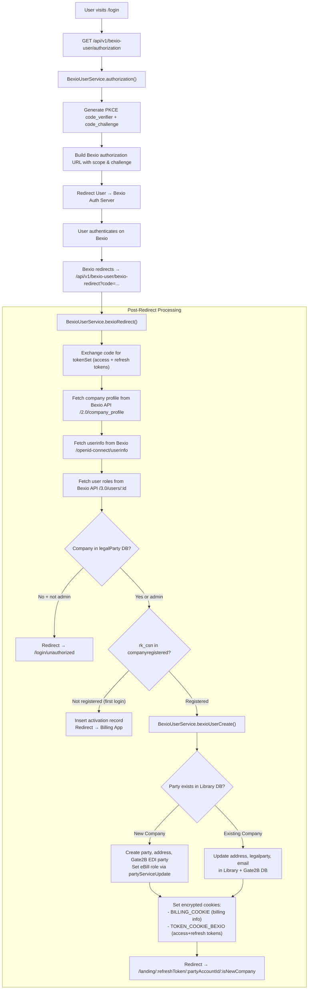
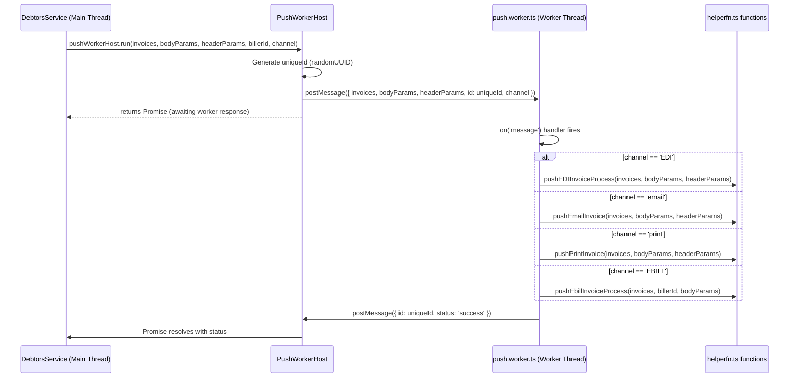

# Architecture

## System Overview

The `Docker-iom-bexio_interface_api` is a NestJS-based backend service that acts as an interface between Bexio (ERP) and various output channels (Gate2B, eBill, Email, Print). It handles invoice processing, contact synchronization, and dashboard analytics.

### High-Level Architecture

## Application Structure

The application is modularized following NestJS best practices. The root module `AppModule` composes the following feature modules:

-   **BexioUserModule**: Handles user authentication via Bexio OAuth2/PKCE and post-login user/company provisioning.
-   **DebtorsModule**: Core logic for processing debtor invoices, including routing and status updates.
-   **CreditorsModule**: Manages creditor workflows.
-   **DashboardModule**: Provides analytics and KPI data for the frontend dashboard.
-   **ConfigurationModule**: Manages global configuration and environment variables.
-   **ContactImportModule**: Handles contact synchronization, specifically importing from Salesforce and pushing to Bexio, with state managed in DynamoDB.
-   **DatabaseModule**: Encapsulates Prisma client for database access.

## Authentication Flow (BexioUserModule)

Authentication is **delegated entirely to Bexio** using **OAuth 2.0 Authorization Code flow with PKCE**. The system does **not** maintain its own user credentials database — Bexio is the identity provider.

### Key Auth Details

| Aspect | Detail |
|---|---|
| **Protocol** | OAuth 2.0 Authorization Code + PKCE |
| **Identity Provider** | Bexio Auth Server (`auth.bexio.com`) |
| **Token Exchange** | `openid-client` library exchanges the code + `code_verifier` for `access_token` + `refresh_token` |
| **Userinfo** | Fetched from `auth.bexio.com/realms/bexio/protocol/openid-connect/userinfo` |
| **Roles** | Fetched from `api.bexio.com/3.0/users/:company_user_id` — `is_superadmin` role = admin access |
| **Session Persistence** | Encrypted cookies (`BILLING_COOKIE`, `TOKEN_COOKIE_BEXIO`) set on `.iomarket.in` domain |
| **Token Refresh** | `/bexio-user/refresh-token` endpoint refreshes via `bexioClient.refresh(refresh_token)` |
| **Company Validation** | Company must exist in IO-Market's `legalParty` DB (or user must be admin) to gain access |

## Request Flow

1.  **Incoming Request**: Client triggers an API call (e.g., `POST /api/v1/debtors/sendInvoice`).
2.  **Middleware**: `cookie-parser` (with the shared `SESSION_SECRET`) parses and verifies the HMAC signature on signed cookies.
3.  **Auth Check (per-request, in-service)**:
    -   There is **no global auth guard**. Each service method individually reads `req.signedCookies[TOKEN_COOKIE_BEXIO_NAME]`, decrypts it with `encryptionControl.decryptCookie()`, and extracts the Bexio `access_token` and `refresh_token`.
    -   If the cookie is absent or tampered with, decryption fails and the method returns `401 unauthorized`.
    -   `express-session` with `RedisStore` is configured in `main.ts` but **the session object is never read or written** by any service method — Redis is not part of the request auth path.
4.  **Controller**: Routes the request to the appropriate service method.
5.  **Service Layer**: Executes business logic.
    -   Queries the database via Prisma.
    -   Calls Bexio REST APIs using the `access_token` from the decrypted cookie.
    -   Offloads heavy tasks to background workers via `worker_threads`.
6.  **Response**: Returns standard JSON response to the client.

## Background Processing (Workers)

> **Important**: The application uses **Node.js built-in `worker_threads`**.

Each worker host (`*Host`) is a NestJS `@Injectable()` service that:
1. Spawns a single persistent `Worker` thread at `onApplicationBootstrap`.
2. Communicates via `postMessage()` / `on('message')` using a unique `randomUUID` per task to correlate responses.
3. The background thread executes the actual channel-specific push logic from `helperfn.ts`.

### Worker Hosts

| Host Class | Worker Script | Responsibility |
|---|---|---|
| `PushWorkerHost` | `push.worker.ts` | Sends invoices to EDI / Email / Print / eBill channels |
| `SendDeliveryNotesHost` | `sendDeliveryNotes.worker.ts` | Processes and sends delivery notes |
| `SchedulerContactImportWorkerHost` | `schedulercontactimport.worker.ts` | Processes contact import jobs (Salesforce → Bexio) |
| `SendOrderWorkerHost` | `sendOrder_worker.ts` | Handles order document push |

### How `PushWorkerHost` Works

## Integrations

-   **Bexio**: Source of truth for contacts and invoices. Also acts as the **identity provider** for authentication.
-   **Salesforce**: External source for contact imports.
-   **Redis**: Distributed session storage and response caching (invoice list cache keyed by partyId + URL params, TTL 2 days).
-   **DynamoDB**: Stores contact import job status and metadata.
-   **Prisma**: ORM for type-safe database interactions across multiple DB clients (`connectBexio`, `connectLibrary`, `connectGate2b`, `connectNewGate2b`).
-   **IO-Market / Gate2B**: Target interface for EDI invoice delivery.
-   **MSSQL**: Used for biller lookups (`connectMssql`) in eBill processing.

## Security

-   **Authentication**: OAuth2 + PKCE, with Bexio as identity provider. Access and refresh tokens stored in encrypted, signed `httpOnly` cookies.
-   **Internal API Protection**: Internal callbacks (e.g., `changeInvoiceSendStatus`) are protected by an `x-internal-secret` header checked against `INTERNAL_SERVICE_SECRET` env var.
-   **CORS**: Strict origin whitelist in production settings.
-   **Validation**: Input sanitization via `class-validator`.

## Environment Boundaries

-   **Development**:
    -   Swagger UI enabled at `/api`.
    -   Relaxed CORS (allows localhost).
-   **Production**:
    -   Swagger disabled (typically).
    -   Strict CORS allowed only for `BEXIO_APP_URL` and `BILLING_URL`.
