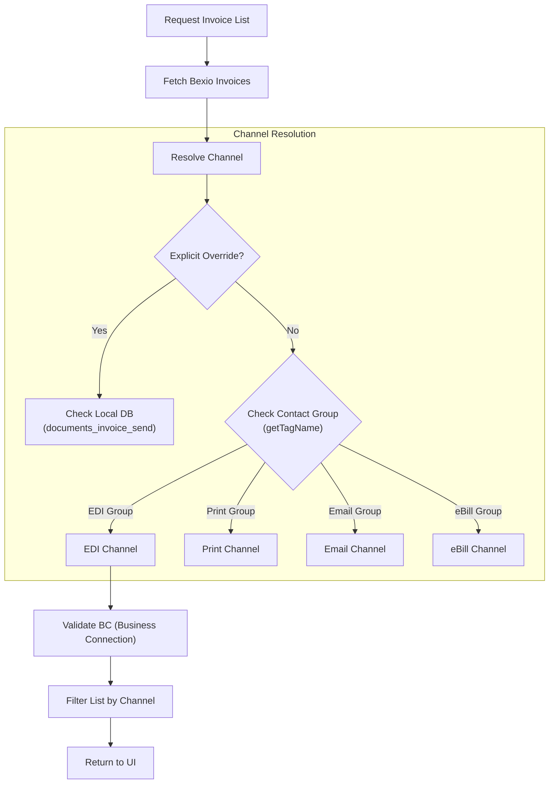
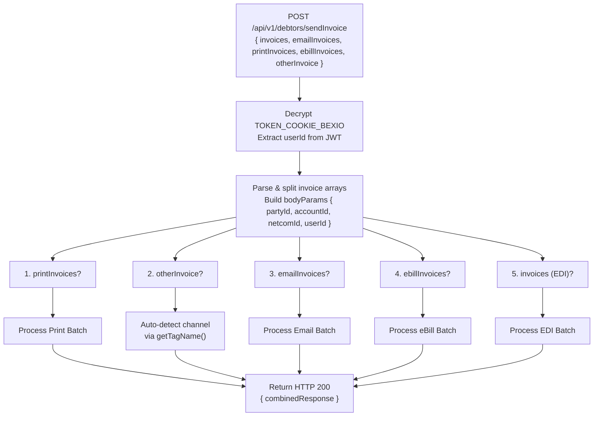
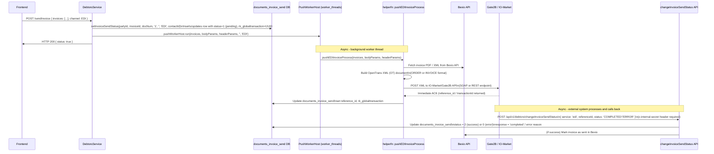
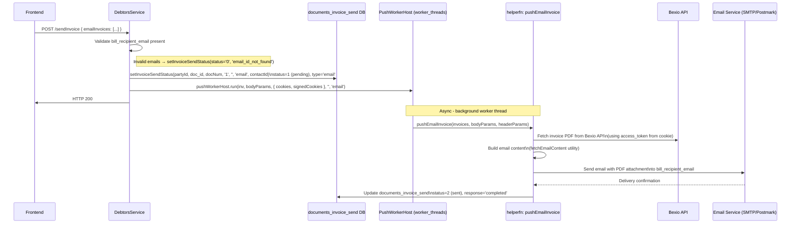
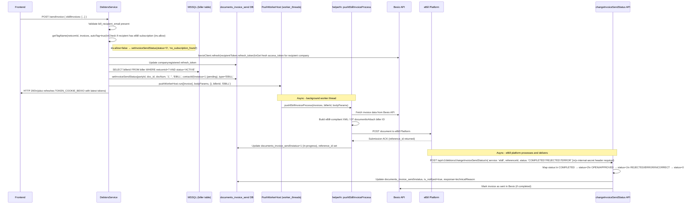
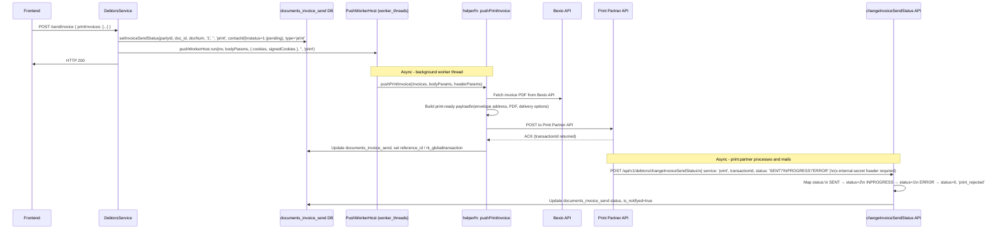

# Invoice Routing Logic

The core value of this application is its ability to route Bexio invoices to the correct output channel (EDI, eBill, Email, Print) based on complex business rules.

## Overview

The routing logic is primarily located in `DebtorsService.getInvoiceV2` (retrieval & classification) and `DebtorsService.sendInvoice` (dispatch).

### Routing Flow

## Channel Determination

### 1. Explicit Routing (Overrides)
Invoices can be manually assigned a channel in the UI. This preference is stored in the local `documents_invoice_send` table.
-   **Priority**: High. Overrides implicit group settings.
-   **Logic**: If an invoice ID exists in the local DB with a specific type, it is treated as that type regardless of contact groups.

### 2. Implicit Routing (Contact Groups)
If no explicit override exists, the routing defaults to the Contact's Group in Bexio via `getTagName()`.
-   **Groups**:
    -   `EDI`: Contacts with valid Business Connections.
    -   `Print` / `Post`: Contacts in the "Print" or "Post" group.
    -   `Email`: Contacts in the "Email" group.
    -   `eBill`: Contacts in the "eBill" group.

### 3. EDI Resolution
EDI is special because it requires a valid technical connection.
-   The system looks up `party_account` → `companyregistered` → `contact_bc`.
-   It filters for connections where `type = 'EDI'` and the supported document type is `Invoice`.

---

## Dispatch Process (`sendInvoice`)

`POST /api/v1/debtors/sendInvoice` is the entry point when the user clicks "Send".

### High-Level Dispatch Flow

> **Worker Mechanism**: All channel dispatches use **`PushWorkerHost.run()`** which sends the job to a persistent **Node.js `worker_threads` Worker** (`push.worker.ts`). The main thread immediately returns HTTP 200 — the actual push happens asynchronously in the background thread.

---

## Per-Channel Process Flow

### Gate2B / EDI Flow

---

### Email Flow

---

### eBill Flow

---

### Print Flow

---

## `changeInvoiceSendStatus` API (Internal Callback)

This endpoint is called by **external services** (eBill platform, Print partner) to asynchronously update invoice delivery status.

| Field | Detail |
|---|---|
| **Endpoint** | `POST /api/v1/debtors/changeInvoiceSendStatus` |
| **Auth** | `x-internal-secret` header must match `INTERNAL_SERVICE_SECRET` env var |
| **Lookup** | Finds `documents_invoice_send` row by `reference_id` OR `rk_globaltransaction` |
| **Bexio Update** | On final success, the Bexio invoice is marked as sent via Bexio REST API |

### Status Mapping

| Service | Incoming Status | Internal Status Code | Meaning |
|---|---|---|---|
| `ebill` | `COMPLETED` | `2` | Delivered successfully |
| `ebill` | `OPEN` / `APPROVED` | `1` | In progress / acknowledged |
| `ebill` | `REJECTED` / `ERROR` / `INCORRECT` | `0` | Failed |
| `print` | `SENT` | `2` | Physically mailed |
| `print` | `INPROGRESS` | `1` | Being processed |
| `print` | `ERROR` | `0` | Failed (`print_rejected`) |

---

## Status Codes in `documents_invoice_send`

| Code | Meaning |
|---|---|
| `1` | Pending / In Progress |
| `2` | Successfully delivered |
| `0` | Failed / Error |
